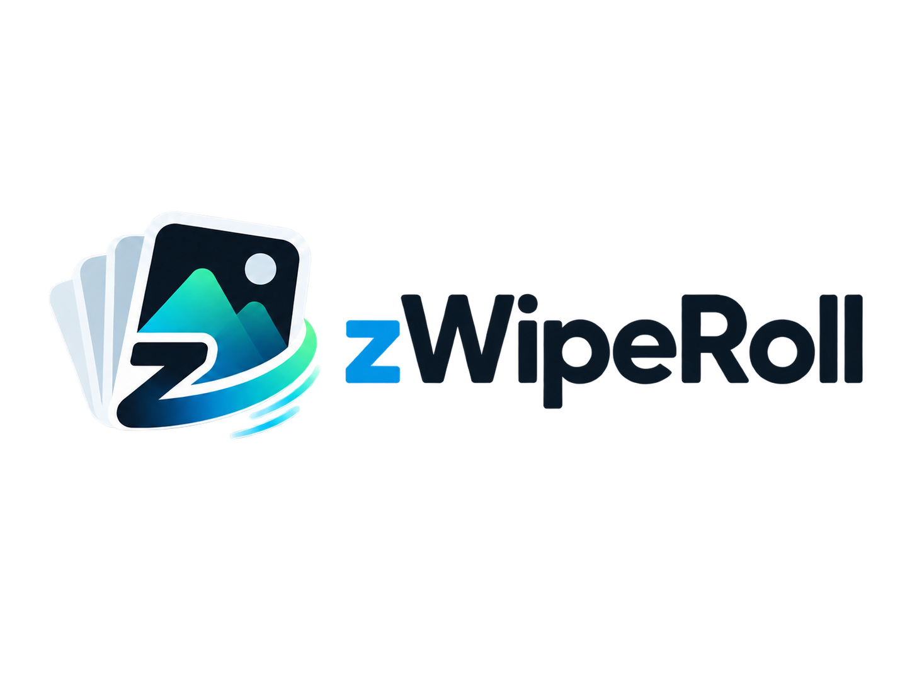

<div align="center">

# zWipeRoll

**Swipe through. Wipe what you don’t need.**

Ultra-fast, native Windows photo declutter & gallery cleaner built with 100% pure Rust. Zero web bloat, zero Electron, zero Tauri.



</div>

---

## ⚡ Perché zWipeRoll?

Windows Foto e l'Esplora Risorse sono notoriamente lenti quando si tratta di fare decluttering e pulizia di migliaia di immagini. **zWipeRoll** è un **decision engine** ad altissime prestazioni per il filesystem locale:

- **100% Pure Rust**: Costruito su `eframe 0.36.1` + `glow` (OpenGL). Nessun runtime Webview, nessun framework JS, zero debito tecnico.
- **Avvio Istantaneo**: Singolo eseguibile `.exe` portatile e avvio in <30ms con soli ~30-50MB di RAM.
- **Viewport-Aware Downscaling**: Le foto (anche da 50+ Megapixel) vengono scalate alla risoluzione dello schermo durante la decodifica worker pool, evitando di saturare la memoria.
- **Decoupling Filesystem / Decisioni**: 
  - `Conserva` non tocca il disco (il file è già dov'è).
  - `Cestina` segna solo una flag in memoria.
  - `Ctrl+Z` / `Undo` è istantaneo a costo I/O zero.
  - Solo nella schermata di **Riepilogo finale** i file vengono inviati in sicurezza nel **Cestino di Windows** (`trash` crate).

---

## 🎮 Controlli & Scorciatoie

| Tasto / Controllo | Azione | Note |
| :--- | :--- | :--- |
| **`D`** (o Swipe Destro) | ⭐ **Conserva** | Segna come conservata e passa alla foto successiva |
| **`A`** (o Swipe Sinistro) | 🗑️ **Cestina** | Segna per il Cestino e passa alla foto successiva |
| **Cerchio Verde** (Click) | ⭐ **Conserva** | Pulsante rotondo verde su schermo |
| **Cerchio Rosso** (Click) | 🗑️ **Cestina** | Pulsante rotondo rosso su schermo |
| **Frecce `←` / `→`** | 🔍 **Scorri** | **Solo scorrimento** avanti/indietro (nessuna decisione presa) |
| **`Ctrl + Z`** / **`U`** | ↩ **Undo** | Annulla l'ultima decisione e torna alla foto precedente |
| **`Esc`** | 📁 **Esci** | Torna alla selezione cartelle o alla dashboard mensile |

---

## 🚀 Due Modalità di Selezione

1. **📁 Cartella Specifica**: Scegli manualmente una cartella singola da ripulire.
2. **🌐 Tutte le Immagini del PC**: Scansiona automaticamente le cartelle immagini standard dell'utente (Immagini, OneDrive, Download) e le ordina cronologicamente.

---

## 🎨 Brand Design & Palette

- **Primary Dark**: `#132230`
- **Background Dark**: `#0F1C27`
- **Surface Dark**: `#182936`
- **Azure (CTA)**: `#0CA5D6`
- **Mint (Accent)**: `#3ACFBF`
- **Keep**: `#22C55E`
- **Danger / Trash**: `#EF4444`
- **Typography**: Manrope (Headings / Logo) + Inter (UI)

---

## 🛠️ Build e Installazione

Requisiti: Rust toolchain installata (`rustup`).

```bash
# Compilazione debug
cargo build

# Compilazione release ottimizzata
cargo build --release
```

L'eseguibile standalone viene generato in `target/release/zwiperoll.exe`.
